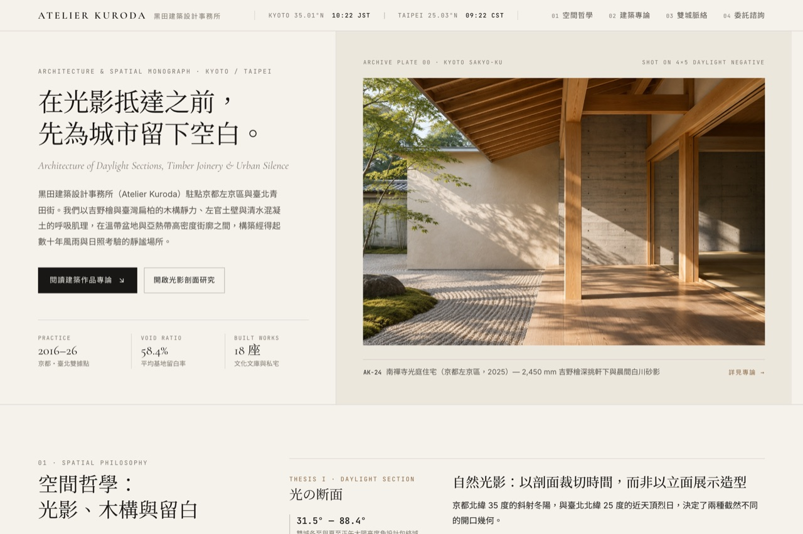
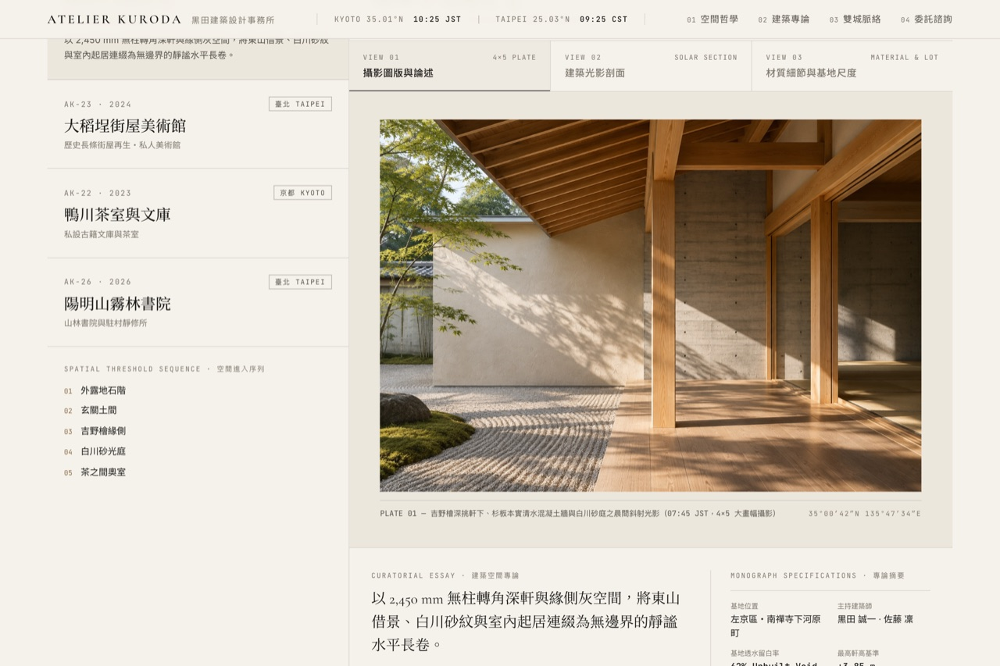
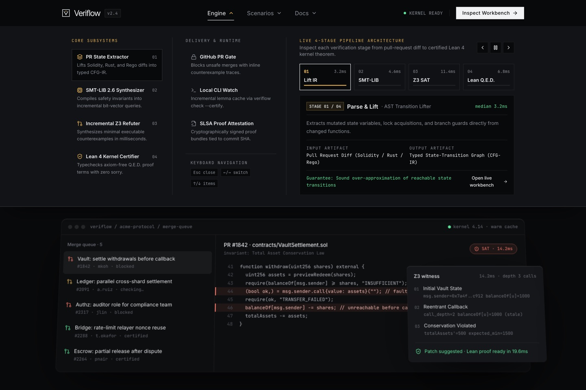
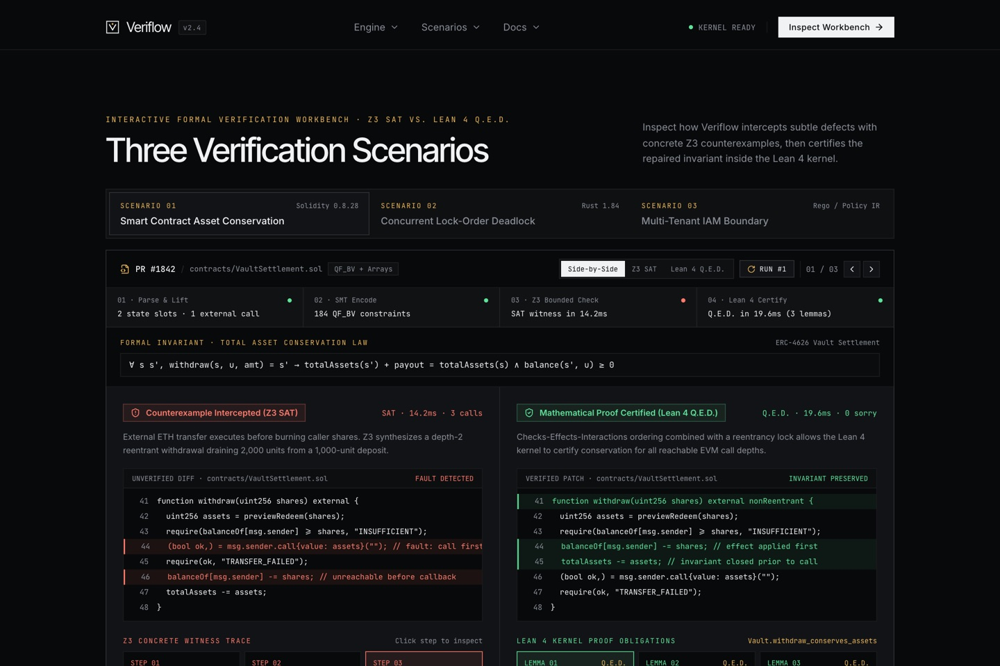
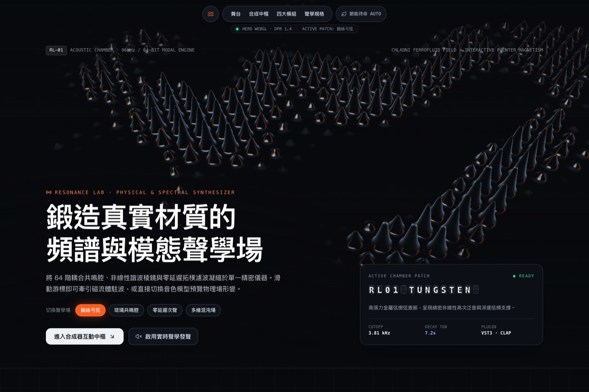
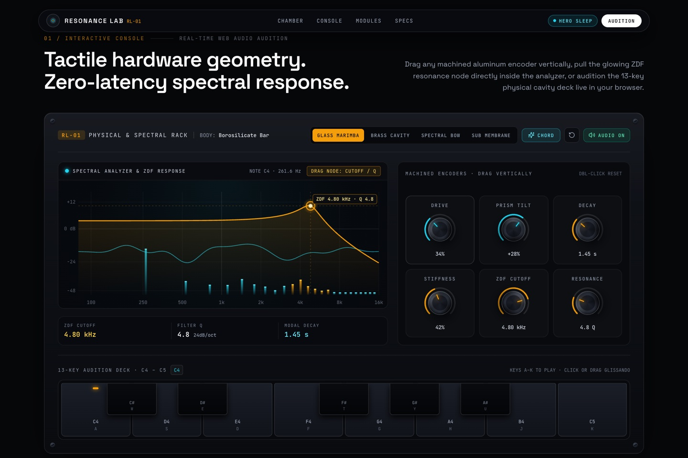

# UI Lookbook

**English** | [繁體中文](README.zh-TW.md) | [简体中文](README.zh-CN.md)

An open-source **Agent Skill** for Codex, Claude Code, and compatible coding agents that bridges the gap between generic AI Tailwind wireframes and studio-grade web design.

Instead of pasting static bookmarks into a prompt or slapping random animations onto bordered white cards, **UI Lookbook** gives your agent a 4-stage visual craft workflow:

1. **Mode Calibration First**: Classifies each project into **Mode A (Editorial & Minimal Restraint)**, **Mode B (Brand Narrative & Local Upgrade)**, or **Mode C (Immersive & Experimental)** so minimal architecture sites stay quiet and restrained while audio/creative labs unleash full interactive WebGL.
2. **Live Original-Site Deep Scouting (`visual_scout.cjs`)**: Visits real featured studio websites from curated galleries (Minimal Gallery, Godly, Awwwards, Curated, Navbar Gallery, Footer Design, Siteinspire, Designeer), captures full `1440×960` desktop views, and extracts computed CSS typography and layout DNA for visual inspection.
3. **Pure Open-Source Component Source Retrieval (`query_refs.py`)**: Searches and fetches real `.tsx` / `.vue` upstream source code directly from MIT-licensed registries (**React Bits**, **Vue Bits**, **Magic UI**, **Aceternity UI**, **Animate UI**, **Cult UI**, **Animata**), then strips hardcoded demo neon palettes to bind your brand's design tokens.
4. **Desktop + Mobile Self-Audit & GPU Hygiene**: Enforces `dpr <= 1.5`, offscreen `IntersectionObserver` pause, `prefers-reduced-motion` fallbacks, CJK typography safety, and post-build `1440×960` + `390×844` headless Chrome verification for `0px` horizontal overflow and zero clipped text.

---

## Visual Showcase (Blind Evaluation Outputs)

All pages below were generated end-to-end by an independent agent equipped with `ui-lookbook` and verified at `1440×960` desktop and `390×844` mobile with `0px` overflow.

### Mode A — Editorial & Minimal Restraint (Zero WebGL, Monograph Grid)
*Atelier Kuroda (Kyoto / Taipei architecture studio): inspired by live Minimal Gallery & Siteinspire architectural studios, pairing borderless Passe-Partout 4×5 photography with hairline monograph typography and interactive solar section diagrams.*

| Hero Spread | Interactive Monograph & Solar Study |
| :---: | :---: |
|  |  |

### Mode B — Brand Narrative & Local Upgrade (Strict Incumbent Token Fidelity)
*Veriflow formal verification page: upgraded only the header Mega Menu and interactive verification workbench while preserving existing `--vf-*` warm-paper design tokens, `Escape`/outside-click focus restoration, and zero mobile overflow.*

| Multi-Column Architecture Mega Menu | Counterexample vs. Lean 4 Proof Workbench |
| :---: | :---: |
|  |  |

### Mode C — Immersive & Experimental (Vue 3 + WebGL2 + Offscreen GPU Sleep)
*Resonance Lab flagship synthesizer: translated from live Godly hardware benchmarks, integrating `@vue-bits` zero-dep WebGL2 `Ferrofluid` standing waves, mechanical `SplitFlapText`, 8 draggable rotary knobs, playable keyboard, and automatic offscreen `HERO SLEEP` GPU throttling.*

| Full-Bleed WebGL2 Ferrofluid Stage | Interactive Synth Console (`HERO SLEEP` Active) |
| :---: | :---: |
|  |  |

---

## Curated Reference Ecosystem

### Open-Source Component & Motion Registries (Direct Source Fetch)

| Library | Stack | Registry Namespace | Best Used For |
| :--- | :--- | :--- | :--- |
| [React Bits](https://reactbits.dev/) | React (TS/JS × TW/CSS) | `@react-bits` | Zero-dep WebGL shaders (`Silk`, `Grainient`, `Aurora`, `Noise`), `SplitFlapText`, `FadeContent`, `TiltedCard`, `Magnet` |
| [Vue Bits](https://vue-bits.dev/) | Vue 3 SFC | `@vue-bits` | Vue-native `Ferrofluid`, `Silk`, `SplitFlapText`, `SplitText`, `SpotlightCard`, `AccordionGallery` |
| [Magic UI](https://magicui.design/) | React + Tailwind | `@magicui` | Restrained landing polish (`magic-card`, `number-ticker`, `marquee`, `bento-grid`, `border-beam`) |
| [Aceternity UI](https://ui.aceternity.com/) | React / Next.js | `@aceternity` | `navbar-menu`, `container-scroll-animation`, `sticky-scroll-reveal`, atmospheric spotlights |
| [Animate UI](https://animate-ui.com/) | React + Radix / Base UI | `@animate-ui` | Smooth stateful transitions (`tabs`, `accordion`, `dialog`, `popover`, `switch`) |
| [Cult UI](https://cult-ui.com/) | React + shadcn | `@cult-ui` | `direction-aware-tabs`, `texture-card`, expandable panels & docks |
| [Animata](https://animata.design/) | React + Tailwind v4 | URL registry | Lightweight animated cards, tickers, and micro-widgets |
| [Codrops](https://tympanus.net/codrops/) / [Uiverse](https://uiverse.io/) | Web / CSS | Reference | Bespoke scroll/WebGL tutorials & atomic pure-CSS controls |

### Design Inspiration Galleries (Live Visual Scouting & Structured Indexes)

- **Whole-Site & Narrative**: [Awwwards](https://www.awwwards.com/), [Godly](https://godly.website/), [CSS Design Awards](https://www.cssdesignawards.com/), [One Page Love](https://onepagelove.com/), [Websitevice](https://websitevice.com/), [Siteinspire](https://www.siteinspire.com/) (public REST API), [Minimal Gallery](https://minimal.gallery/), [Land-book](https://land-book.com/), [Httpster](https://httpster.net/), [Curated](https://curated.design/)
- **Section Craft**: [Navbar Gallery](https://www.navbar.gallery/), [Footer Design](https://www.footer.design/)
- **Experimental & Micro-Craft**: [Brutalist Websites](https://brutalistwebsites.com/), [Designeer](https://designeer.xyz/) (913-item Markdown catalog)

---

## Installation

### Option 1: Codex / Agents Skills Directory (`git clone`)

```bash
# Install for Codex
git clone https://github.com/letr1n1ty/ui-lookbook.git ~/.codex/skills/ui-lookbook

# Optional: share across Claude Code / multi-agent environments
ln -s ~/.codex/skills/ui-lookbook ~/.agents/skills/ui-lookbook
```

### Option 2: Agent Skills CLI

```bash
npx skills add letr1n1ty/ui-lookbook
```

### Prerequisites for Helper Scripts

- **Component & API Lookup (`scripts/query_refs.py`)**: Python 3.10+ (standard library only, zero `pip` dependencies).
- **Live Visual Scouting & Post-Build Audit (`scripts/visual_scout.cjs`)**: Node.js 18+ with Playwright (`npm i -D playwright` or system Chrome + cached Playwright).

---

## Standalone Script Usage

```bash
# 1. Deep-scout 2 real featured studio websites from Minimal Gallery or Godly
node scripts/visual_scout.cjs scout minimal --deep 2 --out /tmp/ui-lookbook-scout
node scripts/visual_scout.cjs scout godly --deep 2 --out /tmp/ui-lookbook-scout

# 2. Browse mode-calibrated MIT component recipes
python3 scripts/query_refs.py recipes --stack react --mode editorial
python3 scripts/query_refs.py recipes --stack vue --mode immersive

# 3. Search across all React or Vue registries and fetch exact upstream source
python3 scripts/query_refs.py registry all "tabs" --stack react
python3 scripts/query_refs.py source cultui direction-aware-tabs
python3 scripts/query_refs.py source vuebits Ferrofluid

# 4. Query fast text/API indexes (cached for 1 hour with 429 stop gate)
python3 scripts/query_refs.py siteinspire --category architecture,minimal --limit 6
python3 scripts/query_refs.py designeer "button"
python3 scripts/query_refs.py llms navbar "mega"

# 5. Run objective desktop (1440x960) + mobile (390x844) audit on your built dist/
node scripts/visual_scout.cjs audit ./my-app --out /tmp/ui-lookbook-audit
```

---

## Repository Layout

```text
ui-lookbook/
├── SKILL.md                           # Core skill instructions & 4-stage workflow
├── agents/openai.yaml                 # Codex UI metadata & implicit invocation policy
├── references/
│   ├── component-registries.md        # MIT component registry routing & GPU/CJK checklist
│   └── inspiration-galleries.md       # Gallery visual scout presets & API commands
├── scripts/
│   ├── query_refs.py                  # Zero-dependency cached registry/API lookup CLI
│   └── visual_scout.cjs               # Headless live-site visual scout & post-build auditor
├── docs/images/                       # Real blind-evaluation showcase renders
├── README.md                          # English documentation
├── README.zh-TW.md                    # Traditional Chinese documentation
├── README.zh-CN.md                    # Simplified Chinese documentation
└── LICENSE                            # MIT License
```

---

## License

Released under the [MIT License](LICENSE). All linked third-party component registries retain their respective open-source licenses.
