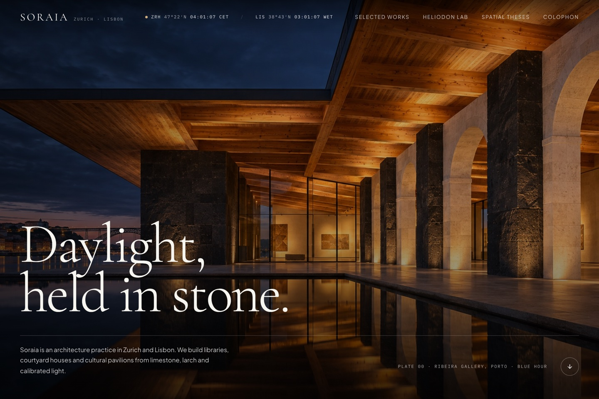
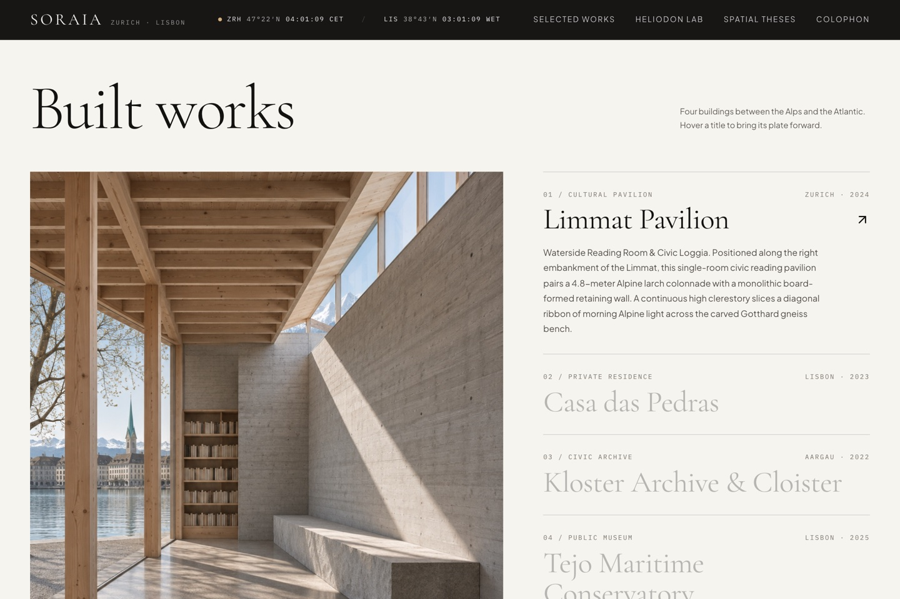
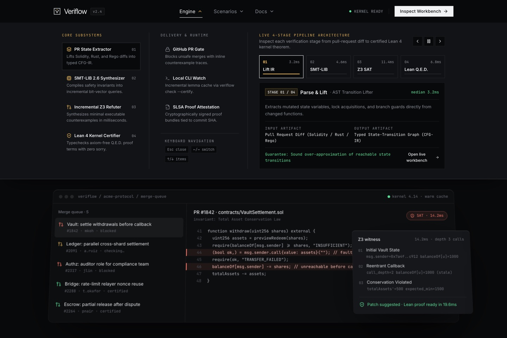
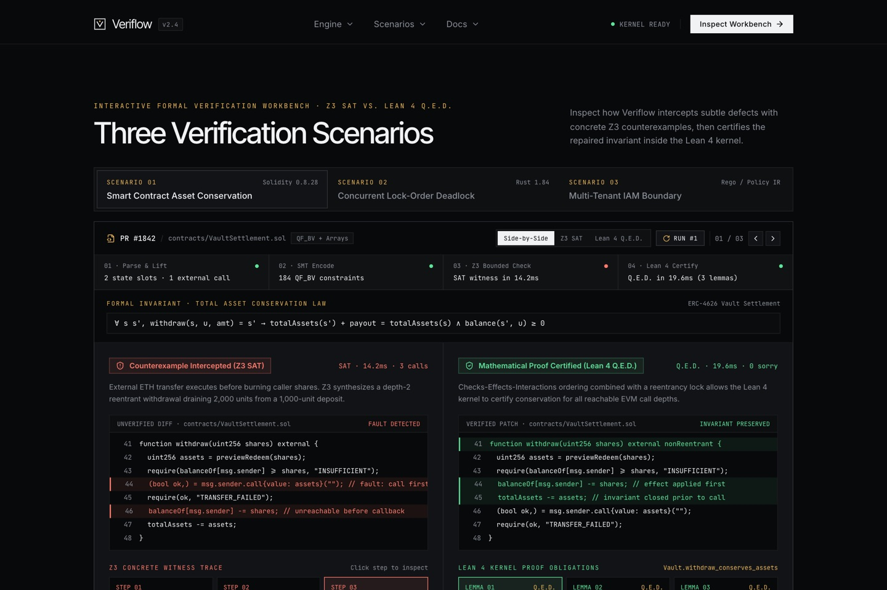
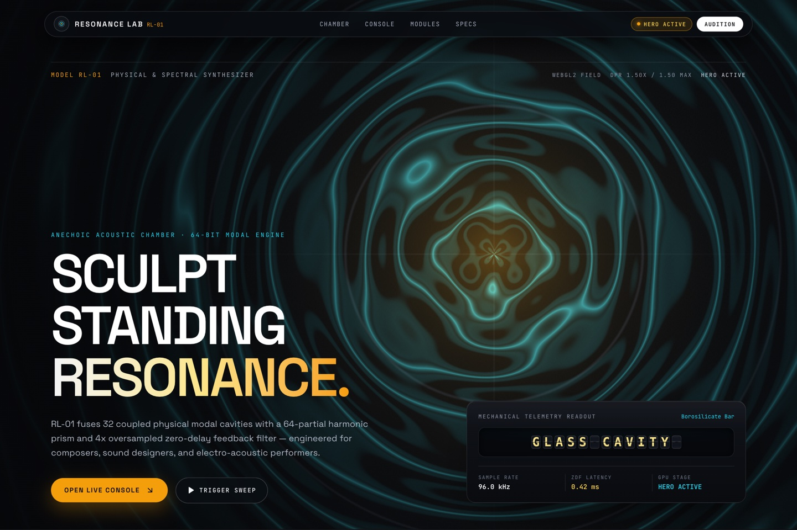
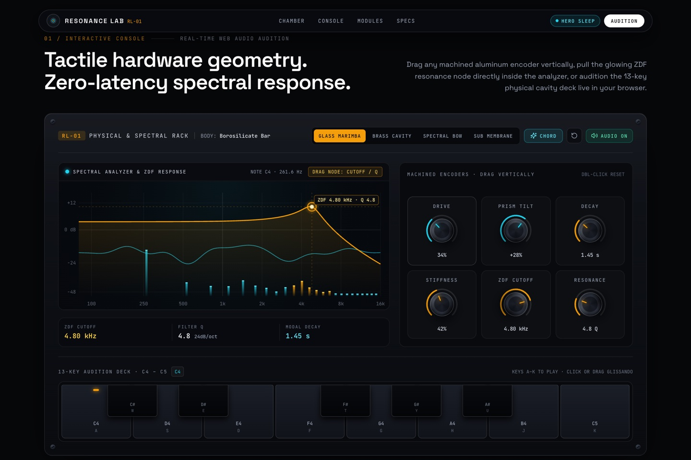

# UI Lookbook

[English](README.md) | [繁體中文](README.zh-TW.md) | **简体中文**

一款面向 Codex、Claude Code 及兼容 AI 编程代理的开源 **Agent Skill**，旨在打破 AI 默认“千篇一律的白底线框卡片”局限，让前端页面真正达到顶级设计工作室水准。

与单纯把参考网址塞进提示词不同，**UI Lookbook** 提供了一套完整的四阶段视觉与工程闭环：

1. **三种美学气质分流（拒绝盲目堆特效）**：开发前先按品牌调性定档为 **Mode A（极简编辑与克制美学）**、**Mode B（品牌叙事与既有系统局部升级）** 或 **Mode C（沉浸声光与实验交互）**，让建筑/艺术类网站保持克制留白，让音频/创意产品释放完整交互张力。
2. **真实入选原站深度视觉侦察（`visual_scout.cjs`）**：不止于读取文字或画廊缩略图墙，而是自动从 Minimal Gallery、Godly、Awwwards、Curated、Navbar Gallery、Footer Design 等精选站点进入 1～2 个真实线上获奖作品原站，截取 `1440×960` 完整首屏与中段画面并提取真实计算字体、字号比例与留白 DNA 供模型直接观察。
3. **纯开源组件源码直取与去模板化（`query_refs.py`）**：跨库检索并直接拉取 MIT 开源组件库（**React Bits**、**Vue Bits**、**Magic UI**、**Aceternity UI**、**Animate UI**、**Cult UI**、**Animata**）的真实 `.tsx` / `.vue` 源码，剥离上游默认的黑紫霓虹演示配色，无缝接入项目自身的设计变量。
4. **双视口完稿自检与 GPU 节能规范**：对 WebGL 及连续动画强制限制 `dpr <= 1.5`、离屏 `IntersectionObserver` 自动休眠与 `prefers-reduced-motion` 静态降级，兼顾中文拆字行高防裁切，并在构建后自动使用无头浏览器验证桌面端（`1440×960`）与移动端（`390×844`）均达到 `0px` 水平溢出且零运行时报错。

---

## 实测成品展示

以下页面均使用 `ui-lookbook` 制作，并通过桌面端 `1440×960` 与移动端 `390×844` 无头浏览器 `0px` 溢出验证。Mode C 由干净上下文子代理端到端生成；Mode A、B 是审查后按修订版构图规则重做，属规则示范，并非盲测产出。

### Mode A — 极简编辑克制（零 WebGL、满版摄影）
*Soraia（苏黎世／里斯本建筑事务所）：从 Siteinspire 建筑类实站（TaylorHare、maximale）读出“首屏由一张满版摄影主导”的构图，转成 100svh 蓝调时刻主视觉、单一主图搭配大字作品索引、可拖拽日照剖面的深色章节与巨型字标页脚。全程零 WebGL。*

| 首屏双联画与双城坐标基准栏 | 交互式建筑作品专论检视台 |
| :---: | :---: |
|  |  |

### Mode B — 品牌叙事与产品舞台（实测 linear.app 侦察）
*Veriflow（形式化验证 SaaS）：转译自实际 `linear.app` 侦察。深色精密画布、紧凑无衬线大标题，首屏主视觉直接是产品本身（合并队列、出错的 diff、Z3 反例检视窗）；Mega Menu 与并排 Z3／Lean 4 工作台保留完整键盘与 Escape 操作。*

| 多栏架构实时预览 Mega Menu | 漏洞反例 vs Lean 4 数学证明工作台 |
| :---: | :---: |
|  |  |

### Mode C — 沉浸声光与实验交互（Vue 3 + WebGL2 + 离屏 GPU 休眠）
*Resonance Lab 旗舰声学合成器：转译自 Godly 入选工业硬件实站构图，集成 `@vue-bits` 零额外依赖 WebGL2 `Ferrofluid` 磁流体驻波雕塑、机械翻牌 `SplitFlapText`、8 颗可拖拽铝合金旋钮、可拖拽频谱节点与 13 键试奏键盘，滚动至中段自动触发 `HERO SLEEP` 离屏节能。*

| 满屏 WebGL2 磁流体驻波主舞台 | 交互式合成器控制中枢（自动离屏 `HERO SLEEP`） |
| :---: | :---: |
|  |  |

---

## 收录资源生态

### 开放授权组件与动效 Registry（支持直接拉取源码）

| 组件库 | 适用技术栈 | Registry 命名空间 | 核心强项 |
| :--- | :--- | :--- | :--- |
| [React Bits](https://reactbits.dev/) | React (TS/JS × TW/CSS) | `@react-bits` | 零额外依赖 WebGL Shader（`Silk`、`Grainient`、`Aurora`、`Noise`）、`SplitFlapText`、`FadeContent`、`TiltedCard`、`Magnet` |
| [Vue Bits](https://vue-bits.dev/) | Vue 3 SFC | `@vue-bits` | Vue 原生 `.vue` 组件：`Ferrofluid`、`Silk`、`SplitFlapText`、`SplitText`、`SpotlightCard`、`AccordionGallery` |
| [Magic UI](https://magicui.design/) | React + Tailwind | `@magicui` | 克制型落地页精修：`magic-card`、`number-ticker`、`marquee`、`bento-grid`、`border-beam` |
| [Aceternity UI](https://ui.aceternity.com/) | React / Next.js | `@aceternity` | `navbar-menu`、`container-scroll-animation`、`sticky-scroll-reveal`、氛围聚光灯 |
| [Animate UI](https://animate-ui.com/) | React + Radix / Base UI | `@animate-ui` | 丝滑状态切换原语（`tabs`、`accordion`、`dialog`、`popover`、`switch`） |
| [Cult UI](https://cult-ui.com/) | React + shadcn | `@cult-ui` | `direction-aware-tabs`、`texture-card`、可展开面板与浮动栏 |
| [Animata](https://animata.design/) | React + Tailwind v4 | URL Registry | 轻量动画卡片、指标与微组件 |
| [Codrops](https://tympanus.net/codrops/) / [Uiverse](https://uiverse.io/) | Web / CSS | 教程与片段参考 | 进阶滚动／WebGL 教程开源项目与纯 CSS 原子控件 |

### 设计灵感画廊与区块标杆（视觉深度侦察＋结构化索引）

- **整站案例与叙事**：[Awwwards](https://www.awwwards.com/)、[Godly](https://godly.website/)、[CSS Design Awards](https://www.cssdesignawards.com/)、[One Page Love](https://onepagelove.com/)、[Websitevice](https://websitevice.com/)、[Siteinspire](https://www.siteinspire.com/)（公开 REST API）、[Minimal Gallery](https://minimal.gallery/)、[Land-book](https://land-book.com/)、[Httpster](https://httpster.net/)、[Curated](https://curated.design/)
- **局部区块精修**：[Navbar Gallery](https://www.navbar.gallery/)、[Footer Design](https://www.footer.design/)
- **独特风格与微交互策展**：[Brutalist Websites](https://brutalistwebsites.com/)、[Designeer](https://designeer.xyz/)（913 项 Markdown 策展目录）

---

## 安装方式

### 方式一：直接克隆到 Codex / Agents Skills 目录

```bash
# 安装到 Codex
git clone https://github.com/letr1n1ty/ui-lookbook.git ~/.codex/skills/ui-lookbook

# 可选：软链接共享到其他多 Agent 环境（如 Claude Code / .agents）
ln -s ~/.codex/skills/ui-lookbook ~/.agents/skills/ui-lookbook
```

### 方式二：通过 Agent Skills CLI 安装

```bash
npx skills add letr1n1ty/ui-lookbook
```

### 辅助脚本运行前提

- **组件与 API 检索（`scripts/query_refs.py`）**：Python 3.10+（仅依赖内置标准库，无需 `pip` 安装）。
- **原站视觉侦察与完稿自检（`scripts/visual_scout.cjs`）**：Node.js 18+ 及 Playwright（`npm i -D playwright` 或本机 Chrome 配合 Playwright）。

---

## 怎么跟 AI 开口？（常用提示词示例）

安装完成后无需记忆脚本命令，直接用自然语言描述你要做的网站或区块即可。如果本机同时装有多个前端设计 Skill，在提示词里带上 `$ui-lookbook` 可确保完整触发“原站看图＋开源组件拉取＋双视口自检”链路。

- **最省心：只说网站类型与气质（自动分流模式并寻找标杆原站）**
  > “帮我用 `$ui-lookbook` 做一个独立精品咖啡烘焙品牌的官网首页，要有纸本杂志般的温润克制感，不要做成模板卡片。”

- **局部精修：升级既有网站的特定区块（严格保留原有配色与结构）**
  > “帮我用 `$ui-lookbook` 把当前网站的顶部导航栏升级为多栏展开 Mega Menu，页脚改为大字标工作室版式，不要改动原有的配色与主体。”

- **指定标杆：贴上你喜欢的参考网址或指定交互手感**
  > “我喜欢 `https://linear.app` 的克制布局节奏，帮我用 `$ui-lookbook` 直接看它的版面参考，并为这个 Vue 3 音乐合成器加上磁流体主视觉和可拖拽旋钮。”

> **小技巧**：在提示词里补充一句**行业领域＋想要的气质或品牌主色**（如“暖白配深墨绿、不要黑底霓虹”），能让 Skill 一次精准锁定对应的美学模式与对口案例。

---

## 辅助脚本独立用法

```bash
# 1. 从 Minimal Gallery 或 Godly 自动进入 2 个真实线上作品站截图并提取排版 DNA
node scripts/visual_scout.cjs scout minimal --deep 2 --out /tmp/ui-lookbook-scout
node scripts/visual_scout.cjs scout godly --deep 2 --out /tmp/ui-lookbook-scout

# 2. 按美学模式浏览精选开源组件配方
python3 scripts/query_refs.py recipes --stack react --mode editorial
python3 scripts/query_refs.py recipes --stack vue --mode immersive

# 3. 跨库搜索并直接拉取上游完整 .tsx / .vue 源码
python3 scripts/query_refs.py registry all "tabs" --stack react
python3 scripts/query_refs.py source cultui direction-aware-tabs
python3 scripts/query_refs.py source vuebits Ferrofluid

# 4. 查询高速文本／API 索引（内置 1 小时本地缓存与 429 停损机制）
python3 scripts/query_refs.py siteinspire --category architecture,minimal --limit 6
python3 scripts/query_refs.py designeer "button"
python3 scripts/query_refs.py llms navbar "mega"

# 5. 对构建后的 dist/ 运行桌面端（1440x960）与移动端（390x844）双视口客观审计
node scripts/visual_scout.cjs audit ./my-app --out /tmp/ui-lookbook-audit
```

---

## 仓库目录结构

```text
ui-lookbook/
├── SKILL.md                           # 核心 Skill 指令与四阶段工作流
├── agents/openai.yaml                 # Codex 界面元数据与触发策略
├── references/
│   ├── component-registries.md        # MIT 组件库选型表与 GPU／中文检查清单
│   └── inspiration-galleries.md       # 灵感画廊视觉侦察预设与 API 命令
├── scripts/
│   ├── query_refs.py                  # 零依赖缓存组件库与 API 检索工具
│   └── visual_scout.cjs               # 无头浏览器原站深度取样与双视口完稿审计工具
├── docs/images/                       # 双盲实测渲染展示截图
├── README.md                          # English 说明文档
├── README.zh-TW.md                    # 繁體中文說明文件
├── README.zh-CN.md                    # 简体中文说明文档
└── LICENSE                            # MIT 开源协议
```

---

## 开源协议

本项目基于 [MIT License](LICENSE) 开源发布。所索引的第三方组件库各自保留其原有开源协议。
