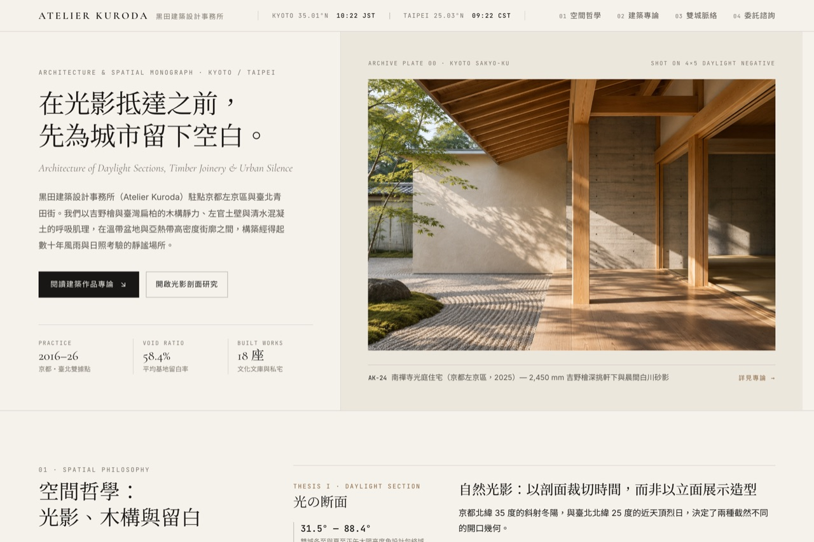
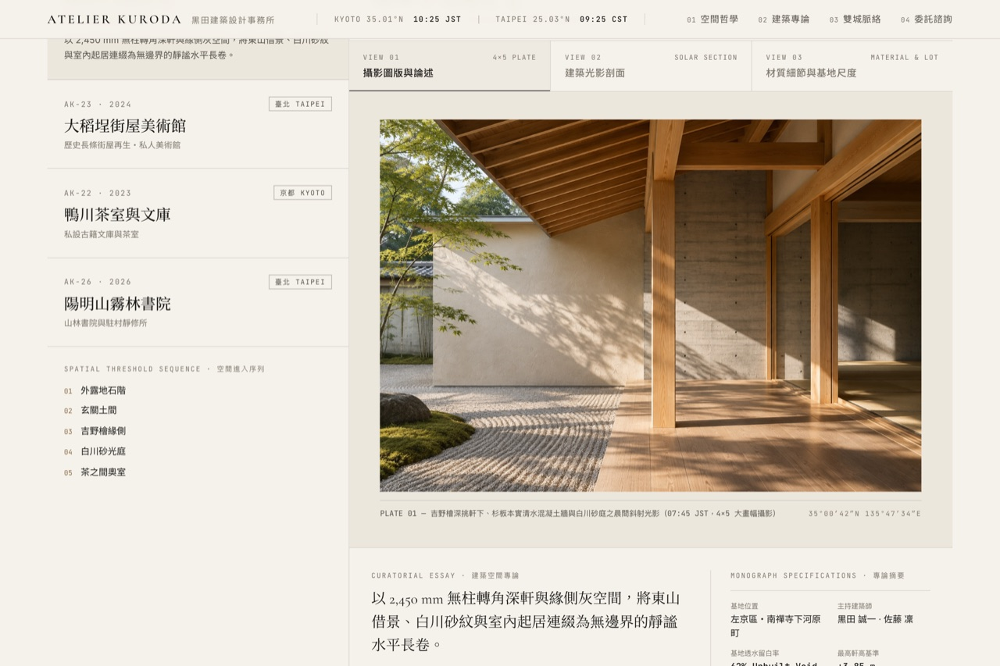
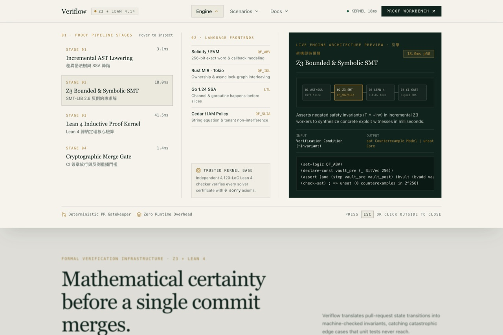
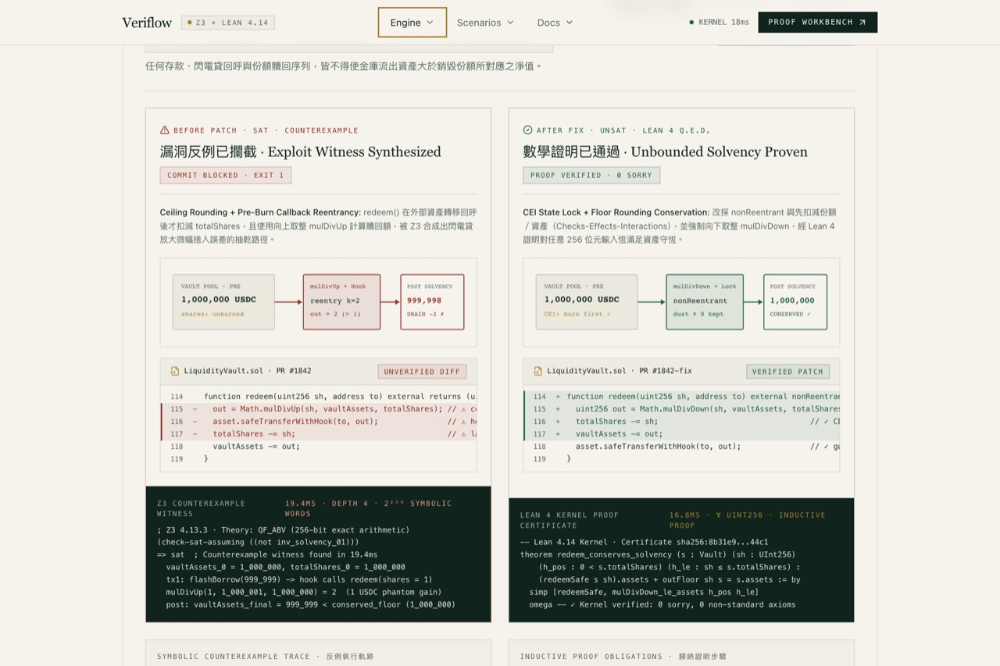
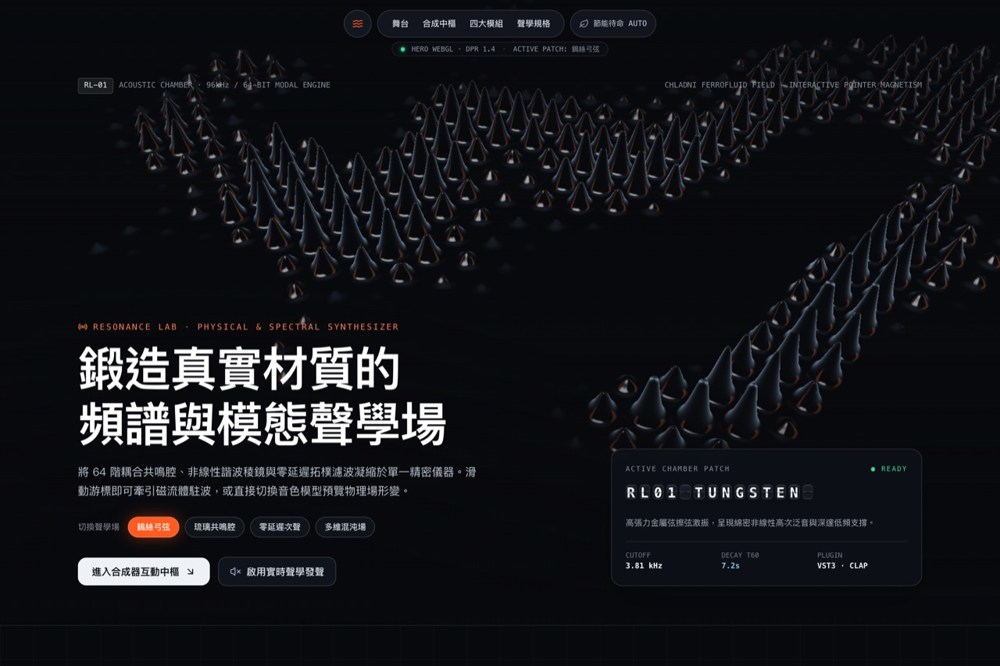
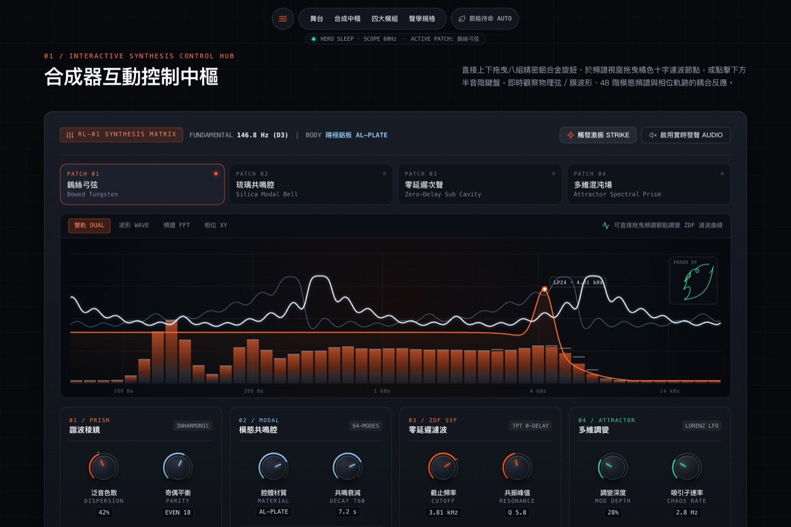

# Vibe UI Refs

[English](README.md) | **繁體中文** | [简体中文](README.zh-CN.md)

一款專為 Codex、Claude Code 與相容 AI 開發代理打造的開源 **Agent Skill**，用來打破 AI 預設「公版白底線框卡片」的天花板，讓前端作品真正對齊國際設計工作室水準。

與單純把設計網站書籤塞進提示詞不同，**Vibe UI Refs** 建立了一套完整的四階段視覺與工程閉環：

1. **三種美學氣質分流（絕不盲目堆特效）**：動工前先依品牌性質定錨為 **Mode A（極簡編輯與奢華克制）**、**Mode B（品牌敘事與既有系統局部升級）** 或 **Mode C（沉浸聲光與實驗互動）**，讓建築與藝術網站維持克制留白，讓音訊／創意工具釋放完整互動張力。
2. **真實入選原站深層視覺偵察（`visual_scout.cjs`）**：不只掃描畫廊文字或縮圖牆，而是自動由 Minimal Gallery、Godly、Awwwards、Curated、Navbar Gallery、Footer Design 等精選站點進入 1～2 個真實線上獲選作品原站，拍攝 `1440×960` 全尺寸畫面並提取計算字體、字級比例與留白 DNA 供模型親眼拆解。
3. **純開源元件原始碼直拉與去模板化（`query_refs.py`）**：直接跨庫搜尋並拉取 MIT 授權元件庫（**React Bits**、**Vue Bits**、**Magic UI**、**Aceternity UI**、**Animate UI**、**Cult UI**、**Animata**）的真實 `.tsx` / `.vue` 原始碼，自動剝離上游預設黑紫霓虹模板色，無縫綁定專案品牌變數。
4. **雙視窗完稿自檢與 GPU 節能紀律**：針對 WebGL／連續動畫強制限制 `dpr <= 1.5`、離屏 `IntersectionObserver` 自動休眠與 `prefers-reduced-motion` 靜態降級，兼顧繁日漢字拆字行高防裁切，並於建置後自動以無頭瀏覽器驗證桌機（`1440×960`）與手機（`390×844`）皆達 `0px` 水平溢位與零執行期錯誤。

---

## 實測成品展示（獨立盲測渲染結果）

以下三組頁面皆由乾淨上下文代理掛載 `vibe-ui-refs` 端對端生成，並通過桌機 `1440×960` 與手機 `390×844` 無頭瀏覽器 `0px` 溢位驗證。

### Mode A — 極簡編輯與奢華克制（零 WebGL、專論無框版式）
*Atelier Kuroda（京都／臺北建築事務所）：深入拆解 Minimal Gallery 與 Siteinspire 建築實站後，完全排除花俏特效，結合無框礦物裱背（Passe-Partout）4×5 自然光建築攝影、雙城即時座標細線與互動太陽高度角剖面研究檯。*

| 首屏雙聯畫與雙城座標基準列 | 互動建築作品專論檢視檯 |
| :---: | :---: |
|  |  |

### Mode B — 品牌敘事與既有系統局部升級（嚴守既有色票變數）
*Veriflow 形式化驗證平台：完整保留既有 `--vf-*` 暖紙深墨視覺系統與首屏結構，僅針對頂部導覽與中段工作台進行精準升級，打造含四階段即時架構預覽的 Mega Menu（支援 `Escape` 歸還焦點）及並排反例／Lean 4 證明工作台，行動版 `0px` 溢位。*

| 多欄架構即時預覽 Mega Menu | 漏洞反例 vs Lean 4 數學證明工作台 |
| :---: | :---: |
|  |  |

### Mode C — 沉浸聲光與實驗互動（Vue 3 + WebGL2 + 離屏 GPU 休眠）
*Resonance Lab 旗艦聲學合成器：轉譯自 Godly 入選工業硬體實站構圖，整合 `@vue-bits` 零額外依賴 WebGL2 `Ferrofluid` 磁流體駐波雕塑、機械翻牌 `SplitFlapText`、8 顆可拖曳鋁合金旋鈕、可拖曳頻譜節點與 13 鍵試奏鍵盤，捲動至中段自動觸發 `HERO SLEEP` 離屏節能。*

| 滿版 WebGL2 磁流體駐波主舞台 | 互動合成器控制中樞（自動離屏 `HERO SLEEP`） |
| :---: | :---: |
|  |  |

---

## 收錄資源生態

### 開放授權元件與動效 Registry（支援直接拉取原始碼）

| 元件庫 | 適用技術棧 | Registry 命名空間 | 核心強項 |
| :--- | :--- | :--- | :--- |
| [React Bits](https://reactbits.dev/) | React (TS/JS × TW/CSS) | `@react-bits` | 零額外依賴 WebGL Shader（`Silk`、`Grainient`、`Aurora`、`Noise`）、`SplitFlapText`、`FadeContent`、`TiltedCard`、`Magnet` |
| [Vue Bits](https://vue-bits.dev/) | Vue 3 SFC | `@vue-bits` | Vue 原生 `.vue` 元件：`Ferrofluid`、`Silk`、`SplitFlapText`、`SplitText`、`SpotlightCard`、`AccordionGallery` |
| [Magic UI](https://magicui.design/) | React + Tailwind | `@magicui` | 克制型產品頁精修：`magic-card`、`number-ticker`、`marquee`、`bento-grid`、`border-beam` |
| [Aceternity UI](https://ui.aceternity.com/) | React / Next.js | `@aceternity` | `navbar-menu`、`container-scroll-animation`、`sticky-scroll-reveal`、氛圍聚光燈 |
| [Animate UI](https://animate-ui.com/) | React + Radix / Base UI | `@animate-ui` | 流暢狀態切換原語（`tabs`、`accordion`、`dialog`、`popover`、`switch`） |
| [Cult UI](https://cult-ui.com/) | React + shadcn | `@cult-ui` | `direction-aware-tabs`、`texture-card`、可展開面板與浮動列 |
| [Animata](https://animata.design/) | React + Tailwind v4 | URL Registry | 輕量互動卡片、指標與微元件 |
| [Codrops](https://tympanus.net/codrops/) / [Uiverse](https://uiverse.io/) | Web / CSS | 教學與片段參考 | 進階捲動／WebGL 教學開源專案與純 CSS 原子控制項 |

### 設計靈感畫廊與區塊標竿（視覺深層偵察＋結構化索引）

- **整站案例與版面敘事**：[Awwwards](https://www.awwwards.com/)、[Godly](https://godly.website/)、[CSS Design Awards](https://www.cssdesignawards.com/)、[One Page Love](https://onepagelove.com/)、[Websitevice](https://websitevice.com/)、[Siteinspire](https://www.siteinspire.com/)（公開 REST API）、[Minimal Gallery](https://minimal.gallery/)、[Land-book](https://land-book.com/)、[Httpster](https://httpster.net/)、[Curated](https://curated.design/)
- **局部區塊精修**：[Navbar Gallery](https://www.navbar.gallery/)、[Footer Design](https://www.footer.design/)
- **實驗風格與微互動策展**：[Brutalist Websites](https://brutalistwebsites.com/)、[Designeer](https://designeer.xyz/)（913 筆 Markdown 策展目錄）

---

## 安裝方式

### 方式一：直接克隆至 Codex / Agents Skills 目錄

```bash
# 安裝至 Codex
git clone https://github.com/letr1n1ty/vibe-ui-refs.git ~/.codex/skills/vibe-ui-refs

# 選用：同步軟連結至其他多 Agent 環境（如 Claude Code / .agents）
ln -s ~/.codex/skills/vibe-ui-refs ~/.agents/skills/vibe-ui-refs
```

### 方式二：透過 Agent Skills CLI 安裝

```bash
npx skills add letr1n1ty/vibe-ui-refs
```

### 腳本執行環境需求

- **元件與 API 查詢（`scripts/query_refs.py`）**：Python 3.10+（僅用內建標準庫，零額外套件安裝）。
- **原站視覺偵察與完稿自檢（`scripts/visual_scout.cjs`）**：Node.js 18+ 與 Playwright（`npm i -D playwright` 或本機已裝 Chrome 搭配 Playwright）。

---

## 輔助腳本獨立用法

```bash
# 1. 從 Minimal Gallery 或 Godly 自動點入 2 個真實線上作品站截圖並提取排版 DNA
node scripts/visual_scout.cjs scout minimal --deep 2 --out /tmp/vibe-scout
node scripts/visual_scout.cjs scout godly --deep 2 --out /tmp/vibe-scout

# 2. 依美學模式瀏覽精選開源元件配方
python3 scripts/query_refs.py recipes --stack react --mode editorial
python3 scripts/query_refs.py recipes --stack vue --mode immersive

# 3. 跨庫搜尋並直接拉取上游完整 .tsx / .vue 原始碼
python3 scripts/query_refs.py registry all "tabs" --stack react
python3 scripts/query_refs.py source cultui direction-aware-tabs
python3 scripts/query_refs.py source vuebits Ferrofluid

# 4. 查詢快速文字／API 索引（內建 1 小時本地快取與 429 停損機制）
python3 scripts/query_refs.py siteinspire --category architecture,minimal --limit 6
python3 scripts/query_refs.py designeer "button"
python3 scripts/query_refs.py llms navbar "mega"

# 5. 對建置後的 dist/ 執行桌機（1440x960）與手機（390x844）雙視窗客觀稽核
node scripts/visual_scout.cjs audit ./my-app --out /tmp/vibe-audit
```

---

## 目錄結構

```text
vibe-ui-refs/
├── SKILL.md                           # 核心 Skill 指令與四階段工作流
├── agents/openai.yaml                 # Codex 介面中繼資料與觸發策略
├── references/
│   ├── component-registries.md        # MIT 元件庫選型表與 GPU／CJK 檢查清單
│   └── inspiration-galleries.md       # 靈感畫廊視覺偵察預設與 API 指令
├── scripts/
│   ├── query_refs.py                  # 零依賴快取元件庫與 API 查詢工具
│   └── visual_scout.cjs               # 無頭瀏覽器原站深層取樣與雙視窗完稿自檢工具
├── docs/images/                       # 雙盲實測渲染展示截圖
├── README.md                          # English 說明文件
├── README.zh-TW.md                    # 繁體中文說明文件
├── README.zh-CN.md                    # 简体中文说明文档
└── LICENSE                            # MIT 授權條款
```

---

## 授權條款

本專案以 [MIT License](LICENSE) 開源釋出。所有連結之第三方元件庫均各自保有其原有開源授權條款。
